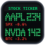
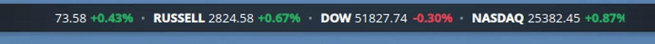
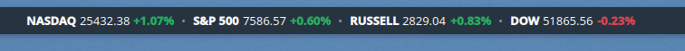

#  Stock Ticker for KDE Plasma (Panel Widget)

A fast, lightweight, and customizable panel widget for **KDE Plasma 6** to monitor real-time market indices, stocks, crypto, and forex directly on your desktop panel or taskbar.

---

## Live Demos and Previews

### 1. Carousel Mode (News Channel Ticker Tape)
Scrolls tickers continuously across a custom width slot. Smoothly pauses on mouse hover:



### 2. Auto-Fit Mode (Side-by-Side)
Expands the panel widget dynamically to display all configured tickers simultaneously:



---

## Features

- **Pre-Configured Market Indices**: Starts right out of the box tracking **NASDAQ** (`^IXIC`), **S&P 500** (`^GSPC`), **Russell 2000** (`^RUT`), and **Dow Jones** (`^DJI`).
- **Two Selectable Display Modes**:
  1. **Auto-Fit All Tickers (Default)**: Automatically expands the panel widget width to display all configured tickers side-by-side at once.
  2. **Carousel Ticker Tape (News Channel Style)**: Constrains the widget to a user-configurable width (in pixels) and scrolls all tickers continuously like a financial news ticker tape (pauses when hovered).
- **Single-Call Batch Fetching (5s Refresh)**: Queries all configured symbols in a **single batched HTTP request** (`/v7/finance/spark`), keeping network overhead minimal and avoiding rate limits even at 5-second refresh intervals.
- **Multi-Instance Deduplication**: Shared `.pragma library` singleton architecture merges symbols across all active widget instances on your panels into one combined API call.
- **Custom Icon and Plasma 6 Native**: Bundled standalone SVG vector icon and Kirigami theme color styling (`positiveTextColor` / `negativeTextColor`).

---

## Directory Structure

```text
stock-ticker-kde/
├── metadata.json              # Applet metadata, plugin ID, version, icon definition
├── contents/
│   ├── icons/
│   │   └── org.kde.plasma.stockticker.svg # Custom high-res vector icon for Plasma and Store
│   ├── config/
│   │   ├── config.qml         # Settings category definition
│   │   └── main.xml           # KConfig schema (symbols, interval, displayMode, carouselWidth)
│   ├── ui/
│   │   ├── main.qml           # Inline panel widget UI (Auto-Fit and Carousel modes)
│   │   └── configGeneral.qml  # Settings UI with Note and API Limits section
│   └── code/
│       └── api.js             # Shared singleton batch fetcher and instance coordinator
├── screenshots/               # Store preview screenshots and demo GIF
│   ├── carousel-demo.gif      # Live animated preview of carousel mode
│   └── panel-preview.png      # High-res screenshot of panel layout
├── LICENSE                    # GPL-3.0
└── README.md                  # Project documentation
```

---

## Notes and API Limits

- **Maximum Tickers per Batch:** The Yahoo Finance batch endpoint accepts up to **20 unique symbols** per single query. If more than 20 symbols are configured across widgets, fallback single-symbol queries are used.
- **Multiple Parallel Widgets:** You can place multiple instances of this widget across panels (or virtual desktops). The widget engine deduplicates all symbols into **1 single HTTP request** across all instances.
- **Safe Polling Rate:** The default **5-second** refresh uses ~720 requests/hour, safely below the ~2,000 requests/hour IP limit.

---

## Installation and Development

### Local Installation / Upgrade

```bash
# Remove existing widget
kpackagetool6 -t Plasma/Applet --remove org.kde.plasma.stockticker

# Install fresh copy
kpackagetool6 -t Plasma/Applet --install .
```

*(If Plasma Shell has cached the previous version in memory, restart it with `kquitapp6 plasmashell && kstart plasmashell`.)*

### Packaging for KDE Store

To create the `.plasmoid` bundle for uploading to [store.kde.org](https://store.kde.org):

```bash
zip -r org.kde.plasma.stockticker.plasmoid metadata.json contents/
```

---

## License

Distributed under the [GNU General Public License v3.0](LICENSE).
